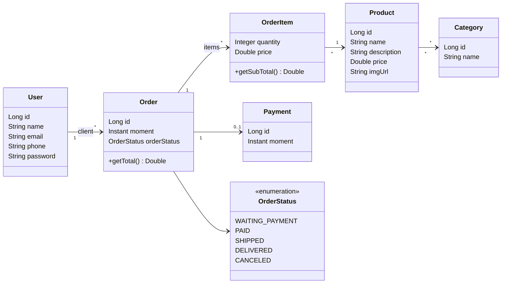

# Workshop Spring Boot + JPA

API REST de um sistema simples de pedidos (usuários, produtos, categorias, pedidos e pagamentos), construída com **Spring Boot**, **JPA/Hibernate** e banco relacional.


---

## Sobre o projeto

Este é o meu **primeiro projeto com Spring Boot**. Ele foi desenvolvido acompanhando o workshop de Spring Boot + JPA do curso **Java COMPLETO**, do professor **Nelio Alves** (DevSuperior).

O curso foi gravado com versões mais antigas do Spring. Eu fiz o projeto com **Spring Boot 4 e Java 25**, então várias coisas não funcionaram como na aula e precisei investigar e adaptar (veja [Desafios que resolvi](#desafios-que-resolvi)).

**O que o projeto pratica:**

- Arquitetura em camadas: **Resource → Service → Repository**
- Injeção de dependência com o Spring
- Mapeamento objeto-relacional com JPA (1:N, N:N, N:N com atributos e 1:1)
- **DTOs** de entrada e saída, separando o que a API expõe das entidades do banco
- Transações com `@Transactional` (leituras com `readOnly = true` e `Propagation.SUPPORTS` no delete)
- CRUD com os verbos HTTP e os status corretos (`200`, `201`, `204`, `404`, `400`)
- Tratamento de exceções centralizado com `@RestControllerAdvice`
- Perfis de execução: **test** (H2 em memória) e **dev** (PostgreSQL)
- Carga inicial de dados (*seeding*) para testes

---

## Tecnologias

| Camada | Tecnologia |
|---|---|
| Linguagem | Java 25 |
| Framework | Spring Boot 4 (Spring Web MVC, Spring Data JPA) |
| ORM | Hibernate 7 / Jakarta Persistence |
| Banco (teste) | H2 em memória, com console web |
| Banco (dev) | PostgreSQL |
| Build | Maven (wrapper incluso, não precisa instalar) |
| Testes manuais | Postman |

---

## Modelo de domínio



### Como cada relação foi mapeada

| Relação | Exemplo | Mapeamento JPA |
|---|---|---|
| Um para muitos | `User` → `Order` | `@ManyToOne` + `@OneToMany(mappedBy)` |
| Muitos para muitos | `Product` ↔ `Category` | `@ManyToMany` + `@JoinTable` (`tb_product_category`) |
| Muitos para muitos **com atributos** | `Order` ↔ `Product` (via `OrderItem`) | Classe de associação com chave composta `@EmbeddedId` (`OrderItemPk`), guardando quantidade e preço no momento da compra |
| Um para um | `Order` → `Payment` | `@OneToOne` + `@MapsId` (o pagamento usa o mesmo id do pedido) |

O `OrderStatus` é gravado no banco como **código numérico** (1 a 5), em vez do texto do enum. Assim, reordenar o enum no código não corrompe os dados.

---

## Arquitetura

```
 Cliente HTTP (Postman, front-end...)
        │  JSON
        ▼
 ┌──────────────┐  DTO   ┌──────────────────────┐ entidade ┌───────────────────┐     ┌───────┐
 │   Resource   │ ◀────▶ │       Service        │ ◀──────▶ │    Repository     │ ──▶ │ Banco │
 │ (controller) │        │  regras de negócio,  │          │ (Spring Data JPA) │     │       │
 │ só cuida do  │        │  @Transactional e    │          │                   │     │       │
 │    HTTP      │        │  conversão DTO ↔     │          │                   │     │       │
 │              │        │  entidade            │          │                   │     │       │
 └──────────────┘        └──────────────────────┘          └───────────────────┘     └───────┘
        ▲
        │ exceções viram respostas HTTP padronizadas
 ┌──────────────────────────┐
 │ ResourceExceptionHandler │  (@RestControllerAdvice)
 └──────────────────────────┘
```

```
src/main/java/com/educandoweb/course
├── config/          # TestConfig: popula o banco no perfil "test"
├── DTO/             # objetos de entrada e saída da API
├── entities/        # entidades JPA (+ enums/ e pk/)
├── repositories/    # interfaces JpaRepository
├── services/        # regras de negócio, transações e conversão DTO ↔ entidade (+ exceptions/)
└── resources/       # controllers REST (+ exceptions/ com o handler global)
```

### Entidades x DTOs

As entidades representam as tabelas e **nunca saem da camada de serviço**. A API recebe e devolve apenas DTOs, montados dentro de uma transação no service. Assim, a senha não vaza, não existe recursão no JSON e cada resposta define até onde a árvore de objetos vai.

| DTO | Onde é usado | O que carrega |
|---|---|---|
| `UserDTO` | respostas de usuário e `PUT /users/{id}` | id, nome, e-mail e telefone (**nunca a senha**) |
| `UserInsertDTO` | `POST /users` | o mesmo que `UserDTO` + `password` |
| `CategoryDTO` | categorias e dentro de produto | id e nome |
| `ProductDTO` | produtos | dados do produto + categorias (`CategoryDTO`) |
| `OrderDTO` | pedidos | cliente (`UserDTO`), itens, pagamento e total |
| `OrderItemDTO` | dentro do pedido | id e nome do produto, preço, quantidade e subtotal |
| `PaymentDTO` | dentro do pedido | id e momento do pagamento |

O `id` enviado no corpo de um `POST` é ignorado: o service sempre cria uma entidade nova e copia apenas os campos permitidos. Assim, um cadastro nunca sobrescreve um registro existente.

---

## Endpoints

Base: `http://localhost:8080`

| Recurso | Método | Rota | Descrição |
|---|---|---|---|
| Usuários | `GET` | `/users` | Lista todos |
| | `GET` | `/users/{id}` | Busca por id |
| | `POST` | `/users` | Cria com `password` no corpo, que nunca é devolvida (retorna `201` + header `Location`) |
| | `PUT` | `/users/{id}` | Atualiza nome, e-mail e telefone |
| | `DELETE` | `/users/{id}` | Remove |
| Produtos | `GET` | `/products` · `/products/{id}` | Lista / busca |
| | `POST` · `PUT` · `DELETE` | `/products` · `/products/{id}` | Cria, atualiza, remove |
| Categorias | `GET` | `/categories` · `/categories/{id}` | Lista / busca |
| | `POST` · `PUT` · `DELETE` | `/categories` · `/categories/{id}` | Cria, atualiza, remove |
| Pedidos | `GET` | `/orders` · `/orders/{id}` | Lista / busca (com itens, pagamento e total) |
| | `PUT` | `/orders/{id}` | Atualiza o status do pedido |
| | `DELETE` | `/orders/{id}` | Remove |

### Exemplo: `GET /orders/1`

```json
{
  "id": 1,
  "moment": "2019-06-20T19:53:07Z",
  "orderStatus": "PAID",
  "client": { "id": 1, "name": "Ruan Lopes", "email": "ruan@gmail.com", "phone": "99929999" },
  "items": [
    { "productId": 1, "name": "The Lord of the Rings", "price": 90.5, "quantity": 2, "subTotal": 181.0 },
    { "productId": 3, "name": "Macbook Pro", "price": 1250.0, "quantity": 1, "subTotal": 1250.0 }
  ],
  "payment": { "id": 1, "moment": "2019-06-20T21:53:07Z" },
  "total": 1431.0
}
```

As datas seguem o padrão **ISO 8601 em UTC** (`Instant`). O `subTotal` e o `total` são calculados na hora da resposta e não ficam gravados no banco.

---

## Tratamento de erros

Todas as exceções de negócio passam por um handler global e voltam num formato único:

```json
{
  "timestamp": "2026-11-24T19:07:09.351Z",
  "status": 404,
  "error": "Resource not found",
  "message": "Resource not found. Id: 99",
  "path": "/users/99"
}
```

| Situação | Exceção | Status |
|---|---|---|
| Buscar, atualizar ou excluir um id inexistente | `ResourceNotFoundException` / `EntityNotFoundException` | `404 Not Found` |
| Excluir um registro que outros usam (ex.: usuário com pedidos) | `DataIntegrityViolationException` → `DatabaseException` | `400 Bad Request` |

---

## Como executar

**Pré-requisito:** JDK 25 ou superior. O Maven já vem no projeto (`mvnw`).

```bash
git clone https://github.com/RuanLopes427/workshop-springboot-jpa.git
cd workshop-springboot-jpa
```

### Perfil `test` (padrão): H2 em memória com dados de exemplo

```bash
# Linux / macOS / Git Bash
./mvnw spring-boot:run

# Windows (PowerShell)
.\mvnw.cmd spring-boot:run
```

O perfil `test` é o padrão em `application.properties`, então **não é preciso instalar nenhum banco**. A API sobe em `http://localhost:8080` já com usuários, produtos, categorias e pedidos cadastrados.

**Console do H2:** acesse `http://localhost:8080/h2-console` e use:

| Campo | Valor |
|---|---|
| JDBC URL | `jdbc:h2:mem:testdb` |
| User Name | `sa` |
| Password | *(vazio)* |

> O banco fica só na memória: ele é recriado a cada execução e some quando a aplicação para.

### Perfil `dev`: PostgreSQL local

1. Crie um banco chamado `springboot_workshop` no PostgreSQL. A URL e o usuário ficam em `src/main/resources/application-dev.properties`.
2. Defina a variável de ambiente `DB_PASSWORD` com a senha do seu usuário `postgres`. A senha não fica no código.
3. Rode a aplicação com o perfil `dev`:

```bash
# Linux / macOS / Git Bash
DB_PASSWORD=sua_senha ./mvnw spring-boot:run -Dspring-boot.run.profiles=dev

# Windows (PowerShell)
$env:DB_PASSWORD="sua_senha"
.\mvnw.cmd spring-boot:run "-Dspring-boot.run.profiles=dev"
```

O Hibernate cria e atualiza as tabelas sozinho (`ddl-auto=update`).

---

## Desafios que resolvi

Por usar versões mais novas que as do curso, alguns comportamentos mudaram, e esses foram os pontos em que mais aprendi:

- **`deleteById` não lança mais exceção para id inexistente.** No Spring Data 3+, ele simplesmente não faz nada e a API devolvia `204`. Passei a verificar com `existsById` antes de excluir, para responder `404`.
- **Atualizar um id inexistente gerava `500`.** O `getReferenceById` lança `EntityNotFoundException` só quando o objeto é usado. Tratei essa exceção no handler global para responder `404`.
- **Excluir um usuário com pedidos gerava `500`.** O banco bloqueia por integridade referencial (chave estrangeira). Capturei a `DataIntegrityViolationException` e devolvo `400` com uma mensagem clara.
- **Recursão infinita no JSON.** Usuário → pedidos → cliente → pedidos... Primeiro quebrei o ciclo com `@JsonIgnore`. Depois, com os DTOs, cada resposta passou a definir até onde a árvore de objetos vai.
- **Perfis do Spring.** O nome do perfil ativo, o sufixo do arquivo `application-{perfil}.properties` e o `@Profile` precisam ser idênticos. Se não forem, o Spring ignora a configuração sem mostrar erro.

Na segunda etapa, troquei a exposição direta das entidades por **DTOs**:

- **`LazyInitializationException` com `open-in-view` desligado.** As listas das entidades (itens, categorias, produtos) são carregadas sob demanda (*lazy*). A conversão para DTO acessava essas listas fora de uma transação e só funcionava porque o `open-in-view` mantinha a conexão aberta durante toda a requisição. Movi a conversão para o service, dentro de `@Transactional(readOnly = true)`, e validei a API com `spring.jpa.open-in-view=false`.
- **`POST` sobrescrevendo registros.** Como o corpo era a própria entidade, mandar `"id": 1` no JSON transformava um cadastro em atualização. Com DTOs de entrada, o service sempre cria uma entidade nova e copia apenas os campos permitidos.
- **Senha só de ida.** O cadastro usa `UserInsertDTO` (herda de `UserDTO` e acrescenta `password`), e as respostas usam `UserDTO`, que nem tem esse campo.
- **`delete` voltando a dar `500` com `@Transactional`.** Dentro de uma transação, o `DELETE` só vai ao banco no *commit*, depois que o método termina, ou seja, fora do `try/catch`. Com `Propagation.SUPPORTS`, o próprio `deleteById` confirma a operação dentro do `try`, e a violação de integridade volta como `400`.

---

## Próximos passos

- [x] Usar **DTOs** para separar a entidade do que a API expõe
- [ ] Criação de pedidos (`POST /orders`) com cliente e itens
- [ ] Validação de entrada com **Bean Validation** (`@NotBlank`, `@Email`...)
- [ ] `BigDecimal` para valores monetários
- [ ] Testes automatizados com **JUnit** e **MockMvc**
- [ ] Documentação interativa com **Swagger / OpenAPI**
- [ ] **Docker Compose** com PostgreSQL

---

## Créditos

Projeto de estudo baseado no workshop do curso **Java COMPLETO**, do professor **Nelio Alves** ([DevSuperior](https://devsuperior.com.br)).

## Autor

**Ruan Lopes**, estudante de Análise e Desenvolvimento de Sistemas.

[](https://github.com/RuanLopes427)
[](https://www.linkedin.com/in/ruan-lopes-8556573b0)
